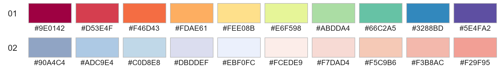
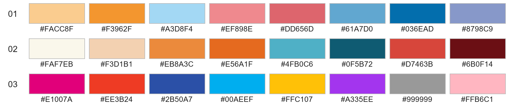
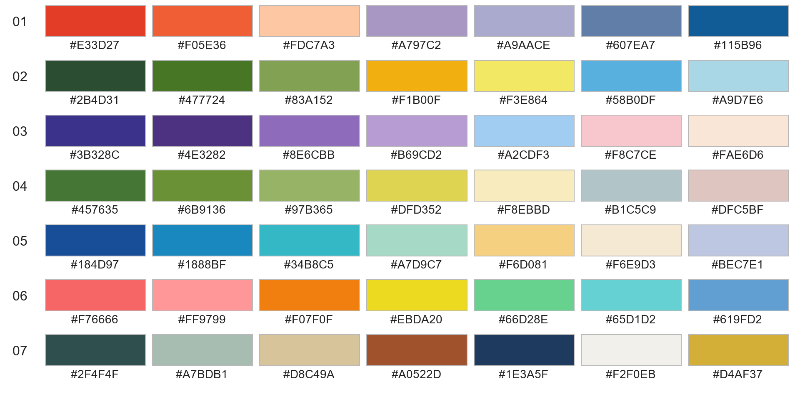
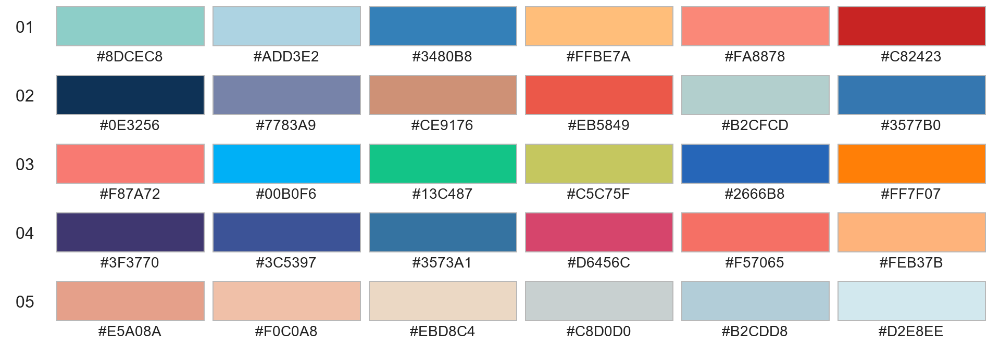
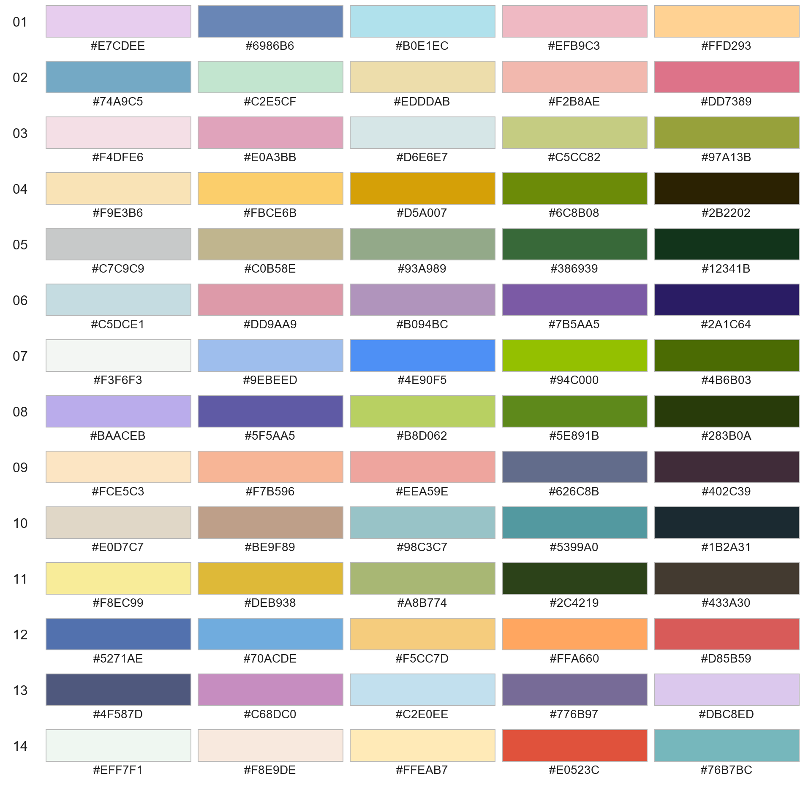
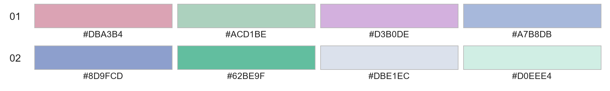
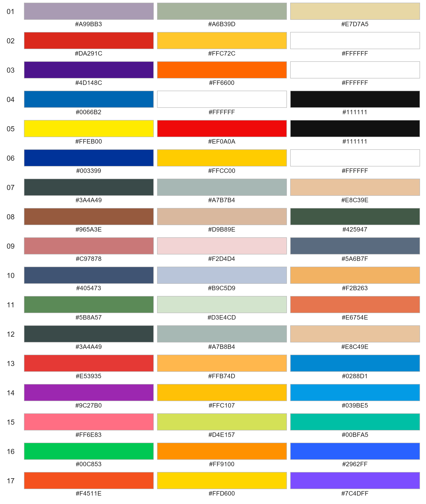
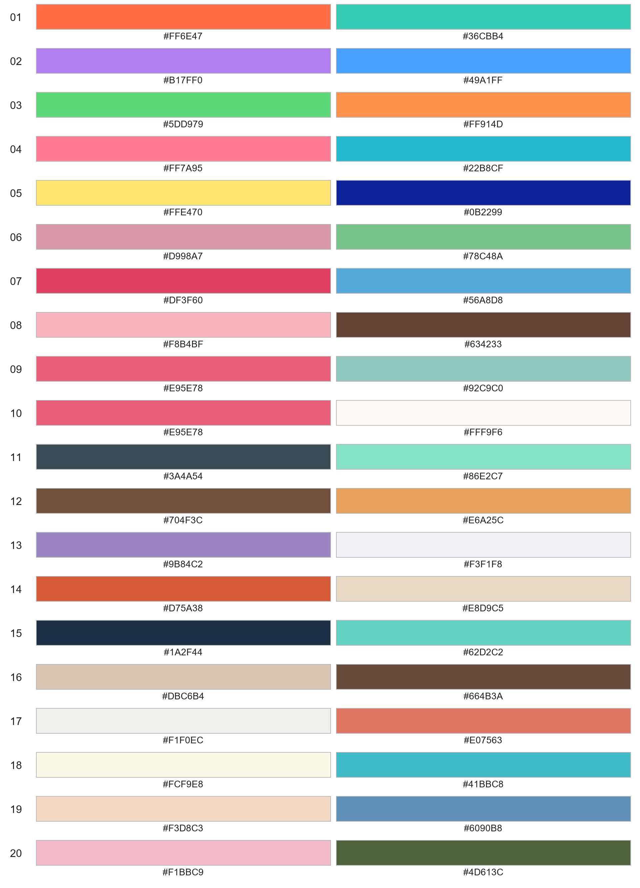

# 配色

配色由用户提供，按颜色数量分组。各组 ID 在组内编号；HEX 值及排列顺序保留原文。每组配色均提供实际色块预览，色块下方标出对应 HEX。

## 10 色 · 2 组

| ID | HEX |
|---|---|
| 01 | #9E0142 #D53E4F #F46D43 #FDAE61 #FEE08B #E6F598 #ABDDA4 #66C2A5 #3288BD #5E4FA2 |
| 02 | #90A4C4 #ADC9E4 #C0D8E8 #DBDDEF #EBF0FC #FCEDE9 #F7DAD4 #F5C9B6 #F3B8AC #F29F95 |

## 8 色 · 3 组

| ID | HEX |
|---|---|
| 01 | #FACC8F #F3962F #A3D8F4 #EF898E #DD656D #61A7D0 #036EAD #8798C9 |
| 02 | #FAF7EB #F3D1B1 #EB8A3C #E56A1F #4FB0C6 #0F5B72 #D7463B #6B0F14 |
| 03 | #E1007A #EE3B24 #2B50A7 #00AEEF #FFC107 #A335EE #999999 #FFB6C1 |

## 7 色 · 7 组

| ID | HEX |
|---|---|
| 01 | #E33D27 #F05E36 #FDC7A3 #A797C2 #A9AACE #607EA7 #115B96 |
| 02 | #2B4D31 #477724 #83A152 #F1B00F #F3E864 #58B0DF #A9D7E6 |
| 03 | #3B328C #4E3282 #8E6CBB #B69CD2 #A2CDF3 #F8C7CE #FAE6D6 |
| 04 | #457635 #6B9136 #97B365 #DFD352 #F8EBBD #B1C5C9 #DFC5BF |
| 05 | #184D97 #1888BF #34B8C5 #A7D9C7 #F6D081 #F6E9D3 #BEC7E1 |
| 06 | #F76666 #FF9799 #F07F0F #EBDA20 #66D28E #65D1D2 #619FD2 |
| 07 | #2F4F4F #A7BDB1 #D8C49A #A0522D #1E3A5F #F2F0EB #D4AF37 |

## 6 色 · 5 组

| ID | HEX |
|---|---|
| 01 | #8DCEC8 #ADD3E2 #3480B8 #FFBE7A #FA8878 #C82423 |
| 02 | #0E3256 #7783A9 #CE9176 #EB5849 #B2CFCD #3577B0 |
| 03 | #F87A72 #00B0F6 #13C487 #C5C75F #2666B8 #FF7F07 |
| 04 | #3F3770 #3C5397 #3573A1 #D6456C #F57065 #FEB37B |
| 05 | #E5A08A #F0C0A8 #EBD8C4 #C8D0D0 #B2CDD8 #D2E8EE |

## 5 色 · 14 组

| ID | HEX |
|---|---|
| 01 | #E7CDEE #6986B6 #B0E1EC #EFB9C3 #FFD293 |
| 02 | #74A9C5 #C2E5CF #EDDDAB #F2B8AE #DD7389 |
| 03 | #F4DFE6 #E0A3BB #D6E6E7 #C5CC82 #97A13B |
| 04 | #F9E3B6 #FBCE6B #D5A007 #6C8B08 #2B2202 |
| 05 | #C7C9C9 #C0B58E #93A989 #386939 #12341B |
| 06 | #C5DCE1 #DD9AA9 #B094BC #7B5AA5 #2A1C64 |
| 07 | #F3F6F3 #9EBEED #4E90F5 #94C000 #4B6B03 |
| 08 | #BAACEB #5F5AA5 #B8D062 #5E891B #283B0A |
| 09 | #FCE5C3 #F7B596 #EEA59E #626C8B #402C39 |
| 10 | #E0D7C7 #BE9F89 #98C3C7 #5399A0 #1B2A31 |
| 11 | #F8EC99 #DEB938 #A8B774 #2C4219 #433A30 |
| 12 | #5271AE #70ACDE #F5CC7D #FFA660 #D85B59 |
| 13 | #4F587D #C68DC0 #C2E0EE #776B97 #DBC8ED |
| 14 | #EFF7F1 #F8E9DE #FFEAB7 #E0523C #76B7BC |

## 4 色 · 2 组

| ID | HEX |
|---|---|
| 01 | #DBA3B4 #ACD1BE #D3B0DE #A7B8DB |
| 02 | #8D9FCD #62BE9F #DBE1EC #D0EEE4 |

## 3 色 · 17 组

| ID | HEX |
|---|---|
| 01 | #A99BB3 #A6B39D #E7D7A5 |
| 02 | #DA291C #FFC72C #FFFFFF |
| 03 | #4D148C #FF6600 #FFFFFF |
| 04 | #0066B2 #FFFFFF #111111 |
| 05 | #FFEB00 #EF0A0A #111111 |
| 06 | #003399 #FFCC00 #FFFFFF |
| 07 | #3A4A49 #A7B7B4 #E8C39E |
| 08 | #965A3E #D9B89E #425947 |
| 09 | #C97878 #F2D4D4 #5A6B7F |
| 10 | #405473 #B9C5D9 #F2B263 |
| 11 | #5B8A57 #D3E4CD #E6754E |
| 12 | #3A4A49 #A7B8B4 #E8C49E |
| 13 | #E53935 #FFB74D #0288D1 |
| 14 | #9C27B0 #FFC107 #039BE5 |
| 15 | #FF6E83 #D4E157 #00BFA5 |
| 16 | #00C853 #FF9100 #2962FF |
| 17 | #F4511E #FFD600 #7C4DFF |

## 2 色 · 20 组

| ID | HEX |
|---|---|
| 01 | #FF6E47 #36CBB4 |
| 02 | #B17FF0 #49A1FF |
| 03 | #5DD979 #FF914D |
| 04 | #FF7A95 #22B8CF |
| 05 | #FFE470 #0B2299 |
| 06 | #D998A7 #78C48A |
| 07 | #DF3F60 #56A8D8 |
| 08 | #F8B4BF #634233 |
| 09 | #E95E78 #92C9C0 |
| 10 | #E95E78 #FFF9F6 |
| 11 | #3A4A54 #86E2C7 |
| 12 | #704F3C #E6A25C |
| 13 | #9B84C2 #F3F1F8 |
| 14 | #D75A38 #E8D9C5 |
| 15 | #1A2F44 #62D2C2 |
| 16 | #DBC6B4 #664B3A |
| 17 | #F1F0EC #E07563 |
| 18 | #FCF9E8 #41BBC8 |
| 19 | #F3D8C3 #6090B8 |
| 20 | #F1BBC9 #4D613C |

[工具文档](tools.md) · [返回画图目录](README.md)
